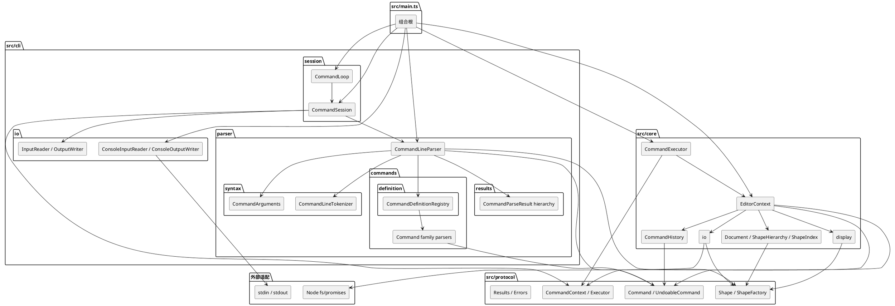

# SVG Editor CLI 架构说明

## 1. 项目范围

本项目实现一个面向 SVG 图形文档的命令行编辑器。当前阶段覆盖：

- `init` / `read` / `save` / `canvas` 文档命令；
- `create` / `delete` / `move` / `scale` / `set` / `group` / `ungroup` / `addto` / `front` / `back` 编辑命令；
- `tree` / `show` / `help` 显示命令；
- 九类编辑命令的 `undo` / `redo` 闭环；
- `rect`、`circle`、`ellipse`、`line`、`text`、`g` 六种图形及嵌套容器；
- SVG 子集读写、缺失 id 自动分配与 IO 后的历史锁。

CLI 通过标准输入逐行读取命令，通过标准输出返回成功摘要或 `error:` 消息。图形统一以 `id` 定位，容器与叶子图形共享 `move`、`scale`、`set`、`delete` 等编辑语义。

本阶段暂不实现 `box` 插件、ShapeProvider 注册表、复杂 SVG 特性（`defs`、外部引用、复杂 `transform` 等）、GUI 或渲染器。因此当前不创建 `final` tag，后续架构重构完成后再确定发布节点。

## 2. 模块划分与职责

| 模块 | 职责 | 允许依赖 |
|---|---|---|
| `src/main.ts` | 组合根，创建 CLI 适配器、Parser、EditorContext 与 CommandExecutor | `src/cli`、`src/core`、`src/protocol` |
| `src/cli/io` | 交互输入输出端口与终端适配器 | 仅自身端口 |
| `src/cli/parser` | 文本到具体 Command 的解析、CLI 解析结果与边界 DTO | `src/protocol` |
| `src/cli/session` | 交互循环、单次命令编排、反馈与继续/退出策略 | `src/cli/io`、`src/cli/parser`、`src/protocol` |
| `src/protocol` | CLI 与 Core 共享的命令模型、图形领域模型、`CommandContext` / `Executor` 端口、结果与错误模型、SVG 图形工厂 | 仅标准 TypeScript/JavaScript 能力，不依赖 `cli`、`core`、Node 或 DOM |
| `src/core` | 应用编排、文档聚合、历史栈、显示格式化、SVG 解析与文件适配 | `src/protocol`；仅 `core/io/FileSvgStorage` 使用 Node `fs/promises` |
| `scripts/e2e.mjs` | 黑盒端到端回归脚本，启动真实编译产物并检查输出与文件结果 | Node 标准库 |
| `tests` | 单元测试、协议测试、Core 协作测试与进程级 E2E 测试 | 按测试对象使用相应模块 |

### 2.1 组件图



图中箭头表示编译期依赖。`src/protocol` 位于中心，但不反向依赖任何应用层或运行时适配层。

### 2.2 核心执行链路

```text
stdin
  -> ConsoleInputReader
  -> CommandLoop
  -> CommandSession
  -> CommandLineParser
  -> 具体 Command
  -> CommandExecutor
  -> EditorContext.execute
  -> command.execute(CommandContext)
  -> Document / Shape / CommandHistory
  -> CommandResultDto
  -> stdout
```

- Parser 只把文本转换为 Command，不执行文档编辑。
- CommandSession 负责单次输入的交互策略：跳过空输入、反馈解析错误、执行命令、输出结果和决定是否退出。
- CommandLoop 只负责提示符、逐行读取、会话生命周期与终止，不解释 Parser 或 Executor 的结果。
- CommandExecutor 负责执行入口与 `ProtocolError -> CommandErrorResult` 转换。
- EditorContext 负责文档生命周期、历史锁和历史记录。
- 具体命令通过 `CommandContext` 操作文档，并通过局部快照实现逆操作。
- `CommandHistory` 只保存成功执行过的 `UndoableCommand`，不保存整文档快照。

## 3. 设计模式与落地位置

| 模式 | 参与者与代码位置 | 解决的问题 | 替代方案与取舍 |
|---|---|---|---|
| Command | `protocol/Command.ts`、`protocol/UndoableCommand.ts`、`protocol/commands/*`；`CommandContext` 是接收者接口 | 把每条 CLI 命令封装为具有身份和行为的对象，编辑命令自带逆操作 | 命令联合类型 + 大 `switch` 会把分发和业务逻辑糅在一起，不采用 |
| Composite | `protocol/shapes/Shape.ts`、`GroupShape.ts` 与五种叶子图形 | 容器与叶子统一支持移动、缩放、公共样式设置和删除 | 在 Context/命令层到处判断 `instanceof GroupShape` 会扩散组合知识，不采用 |
| Factory | `protocol/shapes/ShapeFactory.ts` | 集中处理“图形类型名 -> 具体 Shape”，统一参数校验 | Parser 内重复 `switch(type)` 会产生第二个类型分派点，不采用 |
| Visitor | `protocol/shapes/ShapeVisitor.ts`、各 Shape 的 `accept`；Core 的 `ShapeSummaryVisitor`、`ShapeDetailVisitor`、`SvgShapeWriter` | tree/show/save 需要按具体类型输出不同内容，但不把显示或 SVG 格式知识放进领域对象 | 在显示与序列化层按类型分支会增加分派点，不采用 |
| Memento | `protocol/commands/ShapePlacement.ts`、`ShapeAttributeSnapshot.ts` | 命令保存局部结构与属性状态，实现精确撤销而不复制整份文档 | 整文档快照简单但内存和一致性成本高，也掩盖了命令的真实逆操作，不采用 |
| Facade | `core/EditorContext.ts`、`core/document/Document.ts` | 对 CLI 隐藏文档、历史、错误转换和树/索引协作细节 | 让 CommandSession 直接持有 Document/History 会把应用编排推入 UI 层，不采用 |
| Caretaker | `core/history/CommandHistory.ts` | 管理 undo/redo 两栈，只保存命令引用 | 把历史栈塞进 Document 会混淆聚合根与操作历史职责，不采用 |
| Adapter / Port | `core/io/SvgStorage.ts` 与 `FileSvgStorage.ts` | 隔离文件系统，允许测试注入内存存储 | 在 Context 内直接调用 `fs` 会破坏可测试性和依赖边界，不采用 |

按名字分派只集中在两个位置：`CommandDefinitionRegistry` 的命令名分派和 `ShapeFactory` 的图形类型分派。其他业务流程依赖多态行为，不按 `type` 字段扩散分支。

## 4. 依赖方向与理由

```text
src/main.ts -> src/cli
src/main.ts -> src/core
src/cli -> src/protocol
src/core -> src/protocol
src/protocol -/-> src/cli
src/protocol -/-> src/core
src/core -/-> src/cli
```

理由：

- `protocol` 是 CLI 与 Core 的共同语言。它同时放置 `CommandContext` 与 `Executor` 端口，避免 CLI 为了执行命令反向依赖 Core。
- `cli` 只处理输入输出、解析和协议转换；业务规则与文档状态留在 Core。
- `core` 编排命令执行、历史、文档和 IO；它可以使用 Protocol 的领域对象与端口，但不能依赖 UI 适配器。
- `main.ts` 是唯一知道所有具体实现并完成组装的组合根。
- `protocol` 不依赖 Node/DOM，使未来 GUI、IPC 或测试替代入口可以共享同一命令与图形模型。
- `FileSvgStorage` 是受控例外：只有这个文件系统适配器可以直接使用 Node `fs/promises`，领域与协议层保持运行时无关。

## 5. 未来变化点与预留方式

| 变化点 | 可能的变化 | 当前预留 | 暂不抽象的原因 |
|---|---|---|---|
| 图形类型扩展 | `box`、流程图节点、插件提供的复合图形 | `ShapeFactory` 集中创建；`Shape`/`GroupShape` 支持组合与 Visitor | 尚无插件生命周期和第三方注册需求，提前做注册表会引入不稳定接口 |
| SVG 保真度 | 保留未知元素、注释、`defs`、复杂 `transform`、样式继承 | `SvgStorage`、Parser、Writer 已隔离在 `core/io` | 当前只要求受控子集，复杂 DOM 保真策略尚未确定 |
| 新入口 | GUI、IPC、Web API、批量脚本 | `protocol` 的命令、图形、结果、错误与端口可复用 | 还没有第二个真实入口，不先造通用应用框架 |
| 更多命令或接收者能力 | `CommandContext` 继续增长，或需要拆分能力端口 | 编辑、捕获、显示方法已集中在接口中 | 当前规模可控；若接口继续膨胀，可在重构中按能力拆分 |
| 渲染与预览 | 画布渲染、坐标变换、命中测试 | 领域状态与 CLI 输出解耦 | CLI 阶段没有渲染器需求，不为假设中的 UI 建空抽象 |
| 持久化格式演进 | 文档版本、迁移、非 SVG 存储 | `SvgStorage` 作为文件边界 | SVG 是当前唯一格式，版本迁移需求尚未出现 |

## 6. 过程记录

1. 最初以命令/图形数据联合类型搭建解析与输出骨架，随后重构为 `Command`、`UndoableCommand`、`Shape` 类层次，避免贫血模型和按类型到处分派。
2. 将错误与结果从联合类型改为运行时类层次，在 CLI 边界统一转换为 DTO，保证错误码和消息结构稳定。
3. 从单个文档类中抽出 `ShapeIndex` 与 `ShapeHierarchy`，分别负责身份/父子索引和有序树结构，降低聚合根膨胀风险。
4. 将演示执行器替换为真实 `EditorContext + CommandHistory + Document` 链路，编辑命令开始真正修改文档。
5. 撤销采用命令内局部状态：结构操作保存 `ShapePlacement`，属性操作保存 `ShapeAttributeSnapshot`；恢复时校验父级、索引、重复 id 与祖先冲突。
6. tree/show 通过 Visitor 扩展，不把显示格式写进 Shape；save 复用 Visitor 生成 SVG 元素。
7. SVG read/save 接入后增加 IO 历史锁：`init`/`read` 清空历史，`save`/`canvas` 修改后锁定 undo/redo，下一次成功编辑重新解锁。
8. 收尾时发现 CLI 依赖 Core 中的 `Executor`，将其移到 `protocol`，恢复 `cli -> protocol` 的单向依赖。
9. 调整移动反馈：叶子图形输出绝对位置，容器输出增量；容器没有单一坐标，绝对位置反馈不适用于复合节点。
10. 增加 `scripts/e2e.mjs` 黑盒回归。脚本首次运行时发现提示符替换会误伤 `<file.svg>` 文本，以及 tree 行不是裸 id；据此改为只剥离行首提示符并使用前缀断言。
11. 拆分 CLI 主循环：Parser 负责输入分类，CommandSession 负责单次输入的反馈和继续/退出策略，CommandLoop 只负责提示与读取。未知执行异常不再被循环吞掉，而是交给组合根终止进程。
12. 拆分 Parser：Tokenizer 负责引号感知切词，CommandArguments 负责元数和类型校验，四类命令构造器负责具体对象创建，CommandDefinitionRegistry 集中命令名分派，CommandLineParser 收窄为统一入口。

## 7. 一致性自查

- 实际目录与架构方案一致：`main -> cli + core`，`cli -> protocol`，`core -> protocol`，Protocol 不反向依赖。
- 抽样检查未发现 `src/cli` 或 `src/core` 被 Protocol 导入，也未发现 Core 导入 CLI。
- Command 分发只在 Parser，图形类型创建只在 ShapeFactory；显示和序列化通过 Visitor 多态完成。
- 图形编辑状态保存在命令对象中，Document 不持有历史栈，Context 不保存整文档撤销快照。
- `docs/facts/` 记录实现事实，`docs/plans/` 记录阶段计划，本文件提供面向交付的整体架构说明。
- 当前未打 `final` tag；后续若进行架构重构，应同步更新本文件、事实文档与 E2E 回归脚本。

## 8. 质量保证

本地验证命令：

```bash
npm test
npm run build
npm run test:e2e
npm run e2e
```

覆盖内容：

- Protocol：命令类层次、图形多态行为、属性白名单、工厂校验、结果与错误转换。
- Document：指定索引插入、跨父级恢复、group/ungroup 恢复、空/单子节点容器、非法索引、祖先冲突与失败原子性。
- History 与 EditorContext：成功入栈、失败不入栈、undo/redo、空历史、no-document、历史锁和 `ProtocolError` 映射。
- CLI：真实 Parser/EditorContext/CommandExecutor 的进程级测试，覆盖命令序列与输出。
- SVG IO：解析、元素计数、缺 id 补充、序列化 round-trip、文件错误与 IO 历史锁。
- 黑盒 E2E：`npm run e2e` 构建真实产物后，通过 stdin 运行完整编辑闭环、显示、保存、读入、默认 save 与历史锁，并检查生成文件内容。

`npm run e2e` 使用临时目录并在结束时清理，不依赖仓库内残留文件。它适合在架构重构、命令反馈调整或 IO 行为变化后快速回归关键用户路径。
