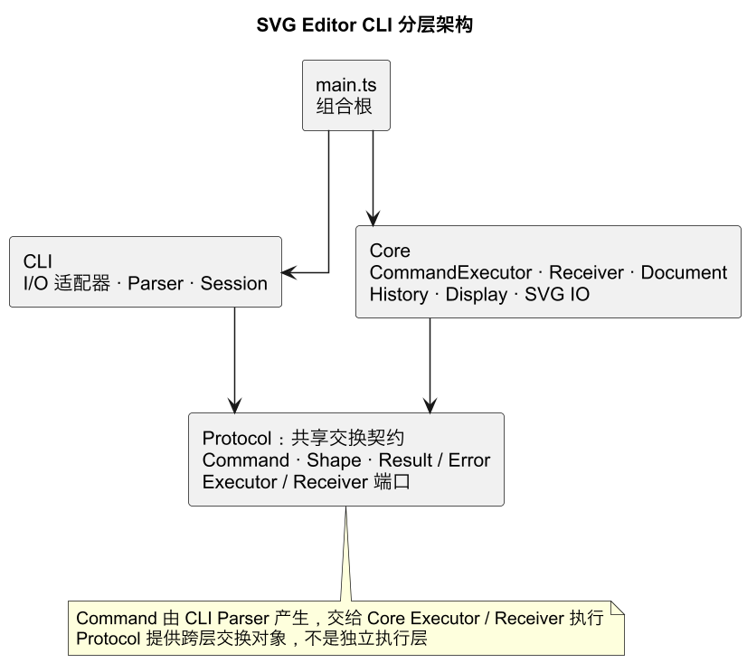
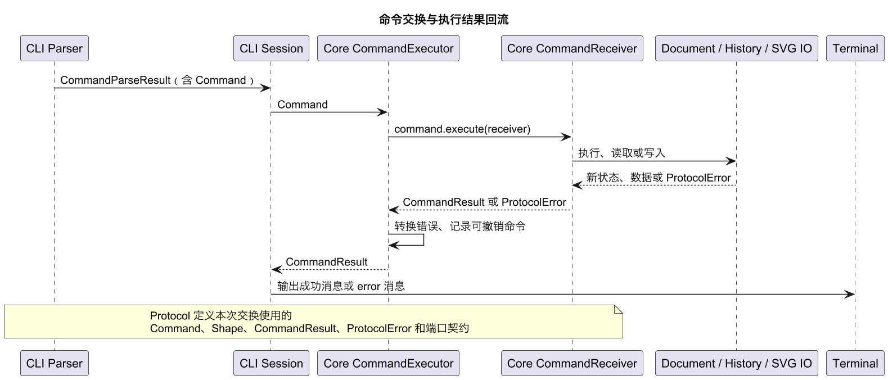

# SVG Editor CLI 架构说明

## 1. 项目范围

本项目实现面向 SVG 图形文档的命令行编辑器。

**Phase 1（tag `final`，版本 `1.0.0`）**

- `init` / `read` / `save` / `canvas` 文档命令；
- `create` / `delete` / `move` / `scale` / `set` / `group` / `ungroup` / `addto` / `front` / `back` 编辑命令；
- `tree` / `show` / `help` 显示命令；
- 九类编辑命令的 `undo` / `redo` 闭环；
- `rect`、`circle`、`ellipse`、`line`、`text`、`g` 六种图形及嵌套容器；
- SVG 子集读写、缺失 id 自动分配与 IO 后的历史锁。

**Phase 2（交付完成后打 tag `p2`，当前未打）**

- 四个扩展点：`ShapeContribution`（角色名 ShapeProvider）、`CommandContribution`、`AttributeHandler`、`TreeDecorator`；
- 命令插件 `stats` / `dir`；图形插件 `box`；树标签 `(box)` 与 `modified-star`；
- 方式 A（代码装配）与方式 B（`plugins.config.json` + `--config`）共用 `PluginHost` 注册路径；
- VSCode 扩展：Explorer `[]` 标记与 Outline 大纲（见第 10 节）。

CLI 通过标准输入逐行读取命令，通过标准输出返回成功摘要或 `error:` 消息。暂不实现复杂 SVG 特性（`defs`、外部引用、复杂 `transform` 等）或独立 GUI 渲染器。

## 2. 模块划分与职责

### 2.1 模块与目录

| 模块 | 职责 | 依赖边界 |
|---|---|---|
| `src/main.ts` | 组合根；组装 CLI/Core，选择方式 A/B 装入插件 | 可依赖 `cli`、`core`、`host`、`assembly`、`protocol` |
| `src/assembly` | 装配：`BuiltinContributionInstaller`（内置命令/图形，`g` 最后注册）、`CodePluginInstaller`（方式 A 的插件清单） | 依赖 `host`、`core`、`protocol`、`_builtin`、`_plugin` |
| `src/host` | 插件宿主与配置加载：`PluginHost`、`PluginModuleLoader`、`loadPluginsFromConfig` | 只依赖 `protocol` + `core`；不导入任何具体插件 |
| `src/cli/io` | `InputReader` / `OutputWriter` 端口及控制台适配器 | 可用 Node `readline`；不依赖 Parser/Session/Core |
| `src/cli/parser` | 切词、参数校验、按 `CommandCatalog` 构造 Command | 仅依赖自身与 `protocol` |
| `src/cli/session` | REPL 与单次输入反馈 | 依赖 `cli/io`、`CommandParser`、`Executor` |
| `src/protocol` | 命令/图形/结果/错误、扩展点契约（Contribution、AttributeHandler、TreeDecorator、SvgPlugin） | 不依赖 `cli`/`core`/`host`/插件/Node/DOM |
| `src/core` | Executor、Receiver、Document、History、Display、SVG IO、各 Registry | 只依赖 `protocol` |
| `src/_builtin` | Phase 1 内置命令与六种图形贡献 | 只依赖 `protocol` |
| `src/_plugin` | 可选插件：stats、dir、box、modified-star（每个插件包独立，互不依赖） | 只依赖 `protocol` 与自身包目录（允许 `node:` 适配器）；由 lint 强制 |
| `scripts` / `tests` | 回归、metrics、双装配校验、E2E | 按对象依赖公开接口 |

实际目录结构如下。README、业务文档和实践说明随模块下沉，避免把全部知识堆在仓库根目录。

```text
src/
├── main.ts
├── host/                            # 插件宿主、配置加载（不含具体插件）
├── assembly/                        # 内置贡献装配、方式 A 插件清单
├── cli/                             # I/O · Parser · Session
├── protocol/                        # 契约与扩展点（含 attributes / tree / plugins）
├── core/                            # Executor · Receiver · Registries · IO
├── _builtin/                        # Phase 1 内置命令/图形贡献
└── _plugin/                         # stats · dir · box · tree 标签插件
```

### 2.2 分层包图

**Phase 1（`final`）**



源文件：[`architecture.puml`](./architecture.puml)。`Protocol` 是 CLI 与 Core 的交换契约，不是第三执行层。

**Phase 2**

源文件：[`architecture-phase2.puml`](./architecture-phase2.puml)（增加 `host`、`_builtin`、`_plugin`）。本地可用 PlantUML 渲染 PNG；未预渲染时以 `.puml` 为准。

### 2.3 命令交换与执行链路

`Command` 不是静态模块块，而是从 CLI Parser 流向 Core Executor / Receiver 的交换对象。命令执行完成后，结果再沿调用链返回 CLI。



```text
stdin
  -> ConsoleInputReader
  -> CommandLoop
  -> CommandSession
  -> CommandParser
  -> CommandLineParser
  -> CommandLineTokenizer
  -> CommandCatalog / CommandRegistry
  -> CommandContribution
  -> ShapeCatalog / ShapeContribution（create 与 SVG 读回）
  -> 具体 Command
  -> CommandExecutor
  -> command.execute(CommandReceiver)
  -> EditorCommandReceiver
  -> EditorDocument / EditorShape / EditorView Receiver
  -> Document / Shape / CommandHistory
  -> CommandResult
  -> CommandResultDto
  -> stdout
```

- `Command` 是 Protocol 定义的交换对象：CLI Parser 构造它，CLI Session 交给 Core Executor，Executor 再把同一个对象交给 Receiver 执行。
- `Protocol` 同时定义这次交换所需的 Command、Shape、CommandResult、ProtocolError，以及 Executor / Receiver 端口；它本身不执行命令。
- 结果沿相反方向返回：Receiver 返回 `CommandResult` 或 `ProtocolError`，Executor 统一转换错误并在需要时记录可撤销命令，Session 转换为边界 DTO 后输出。
- `CommandLoop` 只负责启动提示、提示符、逐行读取和终止；它不解释解析结果或执行结果。
- `CommandSession` 负责单次输入的交互策略：空输入不输出，解析错误输出 `error: ...`，成功结果输出消息，退出结果结束会话。
- `CommandLineParser` 只负责切词、目录查找、`CommandParameters` 创建和解析结果包装；命令名分派集中在 `CommandCatalog` / `CommandRegistry`。
- 每条内置命令的参数解释落在对应 `CommandContribution` 工厂内；`create` 通过 `ShapeCatalog` 查找 `ShapeContribution` 创建具体图形。
- `CommandExecutor` 调用具体 Command，成功且可撤销时立即记录到 `CommandHistory`，再把 `ProtocolError` 转换为错误结果；未知异常继续上抛，由组合根终止进程。
- `EditorCommandReceiver` 把文档、图形、显示能力委托给三个能力对象，并把 undo/redo 委托给共享 History；它不持有文档状态，历史和当前文档分别由 `CommandHistory` 与 `EditorDocumentCommandReceiver` 管理。
- 具体命令通过 `CommandReceiver` 操作文档，并通过 `ShapePlacement` / `ShapeAttributeSnapshot` 保存局部逆操作状态。
- `CommandHistory` 只保存成功执行过的 `UndoableCommand`，不保存整文档快照。

## 3. 设计模式与落地位置

核心类层次如下：

```text
Command
├── UndoableCommand
│   └── create / delete / move / scale / set / group / ungroup / addto / reorder
├── 文档命令：init / read / save / canvas
├── 显示命令：tree / show / help
├── 历史命令：undo / redo
└── 会话命令：exit

Shape
├── StyledShape
│   ├── RectShape
│   ├── CircleShape
│   ├── EllipseShape
│   ├── LineShape
│   └── TextShape
└── GroupShape
```

这里的 `Command` 是跨层流转的请求对象。CLI Parser 创建它，Core Executor 和 Receiver 消费它；图中的类层次表达对象能力，不代表又增加了一个独立的架构层。

| 模式 | 参与者与代码位置 | 解决的问题 | 替代方案与取舍 |
|---|---|---|---|
| Command | `Command` / `UndoableCommand`、语义族具体命令、作为 Invoker 的 `CommandExecutor`、作为 Receiver 的 `CommandReceiver` | 把每条 CLI 命令封装为具有身份和行为的对象；执行与撤销都通过命令对象完成 | 命令联合类型 + Executor 大 `switch` 会把分发和业务逻辑糅在一起，不采用 |
| Composite | `Shape`、`StyledShape`、`GroupShape` 与五种叶子图形 | 容器和叶子统一支持 move、scale、公共样式 set、delete 和显示遍历 | 在命令或 Receiver 中到处判断 `instanceof GroupShape` 会扩散组合知识，不采用 |
| Contribution / Registry | `ShapeContribution` + `ShapeRegistry`，由 `CreateCommandContribution` 和 `SvgDocumentParser` 使用 | 集中处理“图形类型名 / SVG tag -> 具体 Shape”，统一参数与读回 | 各处重复按类型名构造会扩散第二处分派，不采用 |
| Visitor | `ShapeVisitor`、各图形的 `accept`；`ShapeSummaryVisitor`、`ShapeDetailVisitor`、`SvgShapeWriter` | tree/show/save 需要按具体类型输出不同内容，但不把显示或 SVG 格式知识放进领域对象 | 在显示和序列化层按 `type` / `instanceof` 分支会增加分派点，不采用 |
| Memento | `ShapePlacement`、`ShapeAttributeSnapshot`；具体命令创建并在 undo 时恢复 | 保存图形位置、父级、顺序和叶子旧属性，实现局部精确撤销 | 整文档快照会掩盖命令逆操作、增加内存成本，也无法表达恢复前后置条件，不采用 |
| Facade | `EditorCommandReceiver` 聚合 `EditorDocumentCommandReceiver`、`EditorShapeCommandReceiver`、`EditorViewCommandReceiver` 和共享 History；`Document` 聚合树与索引 | 给具体命令和上层流程提供稳定入口，隐藏能力分发与领域协作细节 | 让 Session 直接持有 Document、History 和 IO 会把应用编排推入 CLI，不采用 |
| Caretaker | `CommandHistory` | 管理 undo/redo 两栈和历史锁，只保存命令引用 | 把历史栈塞进 Document 会混淆聚合根与操作历史职责，不采用 |
| Adapter / Port | `Executor`、`CommandReceiver`、`InputReader` / `OutputWriter`、`SvgStorage`、`DirectoryListing` + `NodeDirectoryListing` | 隔离 CLI、Core、终端、文件与目录访问 | 层直接依赖具体类会破坏依赖方向，不采用 |
| Plugin Host | `SvgPlugin`、`PluginContext`、`PluginHost`、配置加载器 | 统一 A/B 装入、清单校验与失败回滚 | 在 main 里直接 `register` 绕过校验会破坏双装配一致性，不采用 |

按名字分派集中在 Registry：命令名、图形类型名、属性处理器名、树装饰器名。Phase 2 角色名 `ShapeProvider` 对应 `ShapeContribution`。

## 4. 依赖方向与理由

```text
main -> cli + core + host + _builtin + _plugin
host -> protocol + core   （方式 A 装配可再依赖 _plugin）
cli  -> protocol
core -> protocol
_builtin -> protocol
_plugin  -> protocol
protocol -/-> cli | core | host | _builtin | _plugin | Node | DOM
```

理由：

- `protocol` 持有交换对象与扩展点契约；实现落在 `_builtin` / `_plugin`，运行时注册表在 `core`。
- `host` 负责装入与清单校验，不属于内核；加载器按模块字符串解析，不 import 具体插件包。
- `cli` / `core` 仍单向依赖 `protocol`；插件不得依赖 `core` / `host` / `_builtin` 内部。
- `main.ts` 是组合根：内置叶子 → 插件 activate → 内置 `g`（保证 box 认领 `data-kind`）。

## 5. 未来变化点与预留方式

| 变化点 | 状态 / 预留 |
|---|---|
| 图形类型扩展 | **已落地** `ShapeContribution` + `box`；可继续加 diamond/arrow 等插件 |
| 命令扩展 | **已落地** `CommandContribution` + `stats`/`dir` + PluginHost |
| 属性语义扩展 | **已落地** `AttributeHandler` |
| 树行标签 | **已落地** `TreeDecorator` |
| 配置装配 | **已落地** 方式 B（`plugins.config.json`） |
| SVG 保真度 / 新入口 / 渲染 | 仍隔离在 IO 与 Protocol，本阶段不扩展 |

## 6. 过程记录

### 6.1 开发策略：先建立行为基线，再重构架构

在提交 `2216dc4 docs: 补充项目交付说明` 之前，开发协作只使用 plan mode：先由 AI 制定并执行计划，按照 TDD 小步推进，由 AI 自行完成测试与实现，最终得到一个行为正确的完整 CLI 实现。这一阶段的首要目标是建立可运行、可验证的业务基线，初步要求AI划分了功能模块并运用了设计模式，但不是一次性追求理想的目录结构。

该提交之后，工作重点转向 refactor，人工Review代码。重构主要关注目录架构、依赖方向和代码可读性，并持续利用已有测试做回归：先在行为保持不变的前提下调整职责边界与目录，再由测试确认命令行为、文档状态、撤销/重做、SVG 读写和 CLI 交互没有被破坏。对每次结构改动都尽量保持提交范围单一，使问题可以定位和回退。

这种“先形成行为基线，再用测试保护持续重构”的过程，是本项目保证代码质量的信心来源。它让我们可以在已经确认功能正确的基础上改善架构，而不是用架构调整替代对业务行为的验证。

### 6.2 关键迭代

1. 最初以命令/图形数据联合类型搭建解析与输出骨架，随后重构为 `Command`、`UndoableCommand`、`Shape` 类层次，避免贫血模型和按类型到处分派。
2. 将错误与结果从联合类型改为运行时类层次，在 CLI 边界统一转换为 DTO，保证错误码和消息结构稳定。
3. 从单个文档类中抽出 `ShapeIndex` 与 `ShapeHierarchy`，分别负责身份/父子索引和有序树结构，降低聚合根膨胀风险。
4. 将演示执行器替换为真实 `EditorCommandReceiver + CommandHistory + Document` 链路，编辑命令开始真正修改文档。
5. 撤销采用命令内局部状态：结构操作保存 `ShapePlacement`，属性操作保存 `ShapeAttributeSnapshot`；恢复时校验父级、索引、重复 id 与祖先冲突。
6. tree/show 通过 Visitor 扩展，不把显示格式写进 Shape；save 复用 Visitor 生成 SVG 元素。
7. SVG read/save 接入后增加 IO 历史锁：`init`/`read` 清空历史，`save`/`canvas` 修改后锁定 undo/redo，下一次成功编辑重新解锁。
8. 收尾时发现 CLI 依赖 Core 中的 `Executor`，将其移到 `protocol`，恢复 `cli -> protocol` 的单向依赖。
9. 调整移动反馈：叶子图形输出绝对位置，容器输出增量；容器没有单一坐标，绝对位置反馈不适用于复合节点。
10. 增加 `scripts/e2e.mjs` 黑盒回归。脚本首次运行时发现提示符替换会误伤 `<file.svg>` 文本，以及 tree 行不是裸 id；据此改为只剥离行首提示符并使用前缀断言。
11. 拆分 CLI 主循环：Parser 负责输入分类，CommandSession 负责单次输入的反馈和继续/退出策略，CommandLoop 只负责提示与读取。未知执行异常不再被循环吞掉，而是交给组合根终止进程。
12. 拆分 Parser：Tokenizer 负责引号感知切词，CommandArguments 负责元数和类型校验，四类命令构造器负责具体对象创建，CommandDefinitionRegistry 集中命令名分派，CommandLineParser 收窄为统一入口。
13. 交付说明提交之后继续按目录职责重构 Parser：将词法和参数校验归入 `syntax`，将命令定义与注册归入 `commands/definition`，将文档、图形、显示命令构造器归入 `commands/CommandsParser`，解析结果独立到 `results`。
14. 重组 Protocol：命令按 `doc`、`shape`、`view`、`history`、`session` 语义族放置，撤销快照单独放入 `memento`；结果与错误分别拆出运行时类层次、具体结果、DTO 目录，Receiver 与执行端口独立成 `receivers`、`execution`。
15. 收窄 Core 协作边界：将编辑器上下文重命名并拆分为 `EditorCommandReceiver` 门面、文档/图形/显示三个能力 Receiver、`CommandExecutor` 和共享 `CommandHistory`；历史集合与历史锁归 History 管理，当前文档和文件路径归文档 Receiver 管理，CLI 不再依赖 Core 内部状态。

## 7. 一致性自查

- 依赖：`main -> cli + core + host + _builtin + _plugin`；`host/cli/core/_builtin/_plugin -> protocol`；`protocol` 不反向依赖。
- `npm run lint` 检查 `_builtin` / `_plugin` 分层导入。
- 扩展点调用只经 Catalog/Registry；显示与 SVG 写出经 Visitor。
- `CommandExecutor` 是成功命令入栈点；`CommandHistory` 独占撤销栈与历史锁。
- Phase 1 行为由 `final` 标记；Phase 2 文档与校验就绪后再打 `p2`（见 metrics 与双装配校验）。

## 8. 质量保证

```bash
npm test
npm run build
npm run lint
npm run test:e2e
npm run e2e
npm run metrics
npm run verify:dual-assembly
```

覆盖：Protocol/Document/History/CLI、插件单测（含 `dir` 替身与真实 FS）、加载器失败路径与回滚、进程级 A/B 一致性、黑盒 E2E。

---

## 9. Phase 2 扩展点清单

| 扩展点（角色名） | 接口 / 抽象类 | 职责 | 内核调用位置 | 已有实现 | 禁用可选扩展时 | 违约时报错（代码位置） |
|---|---|---|---|---|---|---|
| ShapeProvider（代码名 `ShapeContribution`） | 抽象类 `ShapeContribution` + `ShapeCatalog` | 按类型名创建；按 tag/`data-kind` 读回 | `CreateCommandContribution`；`SvgDocumentParser` → `ShapeRegistry.find` / `findForSvg` | `_builtin` 六种；`_plugin` `box` | 仅六种内置；带 `data-kind=box` 的 g 降级为普通 `GroupShape` | 类型名为空：`ShapeContribution` 构造器；重复类型名：`ShapeRegistry` 的 `duplicate shape type`；未知类型：`CreateCommandContribution` 的 `unknown shape type` |
| Command | 抽象类 `CommandContribution`（模板方法 `createCommand` → `buildCommand`）+ `CommandCatalog` | 命令名、help、参数→Command | `CommandLineParser` → `CommandRegistry.find` | Phase 1 内置；`stats`、`dir` | help/执行无插件命令；`error: unknown command: <name>` | 名称/用法为空：`CommandContribution` 构造器；`buildCommand` 未返回 `Command`：`CommandContribution.createCommand`；重复名：`CommandRegistry` 的 `duplicate command`；执行期抛非协议异常：`CommandExecutor` 转 `command-failed` |
| AttributeHandler | 抽象类 `AttributeHandler` + `AttributeCatalog` | 图形+属性领域语义 | `EditorShapeCommandReceiver.setAttribute` / 撤销恢复 → `AttributeRegistry.find` | `BoxAttributeHandler`（`fill`/`label`） | 仅 Phase 1 白名单；`label` 等扩展属性执行期失败 | 多处理器命中：`AttributeRegistry` 的 ambiguous；重名：`duplicate attribute handler`；`apply` 抛错：快照回滚且不入历史（`EditorShapeCommandReceiver`） |
| TreeDecorator | 抽象类 `TreeDecorator` + `TreeDecoratorCatalog` | tree 行尾标签；IO 后同步基线 | `TreeDisplay` 拼接；`EditorDocumentCommandReceiver.syncTreeDecorators` | `box-type-label`、`modified-star` | tree 输出与 Phase 1 逐字节一致 | 重名：`TreeDecoratorRegistry` 的 `duplicate tree decorator` |

插件注册阶段的契约校验（清单与实际注册集合不一致、重复注册、模块缺失/无默认导出/激活失败）由 `PluginHost` / `PluginModuleLoader` 负责，见第 10 节。

插件以类实现扩展点，经 `SvgPlugin.activate(PluginContext)` 注册；不得依赖 `core`/`host` 内部。

## 10. 两种装配方式与配置格式

**共用路径**：`PluginHost.activate`（暂存 → `contributes` 集合校验 → commit）。

**方式 A（改代码）** — 默认启动：

```ts
// src/assembly/CodePluginInstaller.ts
await host.activate(new StatsCommandPlugin(), PluginContributes.of({ commands: ["stats"] }));
// … dir、box、modified-star
```

**方式 B（改配置）**：

```bash
node dist/main.js --config plugins.config.json
```

```json
{
  "plugins": [
    { "module": "./dist/_plugin/commands/StatsCommand" },
    { "module": "./dist/_plugin/commands/DirCommand" },
    { "module": "./dist/_plugin/shapes/BoxShape" },
    { "module": "./dist/_plugin/tree/ModifiedStarPlugin" }
  ]
}
```

- `enabled: false` 跳过；`options` 经 `PluginContext.getOptions()` 传入（如 dir 的 `directoryPath`）。
- 相对 `module` 以配置文件目录为基准；`package.json` 的 `contributes` 提供 `shapes`/`commands`/`attributes`/`decorators` 名称列表。
- 失败输出：`plugin not found` / `no default export` / `manifest mismatch` / `failed to activate` / `duplicate registration` / `invalid plugin config`；失败插件回滚，主程序继续。

证明材料：`docs/facts/dual-assembly-proof.md`；自动化 `npm run verify:dual-assembly`；transcript 在 `doc/transcript/`。

## 11. `dir` 与目录访问适配器

- 端口：`protocol/io/DirectoryListing`（只描述列出目录条目）。
- 适配器：`_plugin/commands/DirCommand/NodeDirectoryListing`（Node `fs`）。
- `DirCommand` 只依赖端口；测试可注入替身。真实 FS 与替身测试见 `tests/_plugin/commands/DirCommand/`。
- 排序：目录在前、文件在后，组内按 UTF-16 码元序（与区域设置无关，大写先于小写，`.` 先于字母）。
- **符号链接规则**：不跟随链接目标；`Dirent.isDirectory()` 为假的条目（含指向目录的符号链接）一律以 `[FILE]` 列出。
- 不接收参数；不读写文档、不入 undo 栈；读取失败返回 `error: cannot read directory: <path>`。

Adapter 角色对应：Client = `DirCommand`；Target = `DirectoryListing`；Adapter = `NodeDirectoryListing`；Adaptee = `node:fs/promises.readdir`。

这是 Adapter：插件命令面向稳定端口，文件系统细节留在适配器。

## 12. ADR 与指标

- ADR：[`docs/adr/`](../docs/adr/)（属性契约、box 降级、dirty 语义、清单校验时机）。
- Metrics：`npm run metrics` → [`docs/metrics/summary.md`](../docs/metrics/summary.md)（相对 `final`（终点为标签 `p2`，未创建时用 `HEAD`）的内核/装配/插件行数与圈复杂度增量，复杂度由 TypeScript AST 逐函数计算；含文件职责清单，VSCode 扩展单独列出；脚本生成、禁止手填）。

## 13. VSCode 扩展（第一部分）

源码：`vscode-extension/`。

- A.1 Explorer 中 `.svg` 旁 `[]` 标记（不改文件名）。
- A.2 原生 Outline 嵌套层级、定位与编辑更新；不完整 XML 不崩溃。
- A.3 分析：[`docs/pj1-phase2-2/vscode-extension/analysis.md`](../docs/pj1-phase2-2/vscode-extension/analysis.md)；效果图：`outline-and-badge.png`。

安装/调试见 `vscode-extension/README.md`（F5 启动 Extension Development Host）。

与 CLI 复用结论见 A.3：Outline 解析与 CLI 的 SVG 子集模型目标不同，本阶段未强行共用 Phase 1 Parser，而以轻量 Outline 解析 + Visitor 产出 `DocumentSymbol`。
