# SVG Editor CLI 架构说明

## 1. 项目范围

本项目实现一个面向 SVG 图形文档的命令行编辑器。当前阶段覆盖：

- `init` / `read` / `save` / `canvas` 文档命令；
- `create` / `delete` / `move` / `scale` / `set` / `group` / `ungroup` / `addto` / `front` / `back` 编辑命令；
- `tree` / `show` / `help` 显示命令；
- 九类编辑命令的 `undo` / `redo` 闭环；
- `rect`、`circle`、`ellipse`、`line`、`text`、`g` 六种图形及嵌套容器；
- SVG 子集读写、缺失 id 自动分配与 IO 后的历史锁。

CLI 通过标准输入逐行读取命令，通过标准输出返回成功摘要或 `error:` 消息。图形统一以 `id` 定位，容器与叶子图形共享 `move`、`scale`、`set`、`delete` 等编辑语义。

本阶段暂不实现 `box` 插件、ShapeProvider 注册表、复杂 SVG 特性（`defs`、外部引用、复杂 `transform` 等）、GUI 或渲染器。架构重构已在行为基线完成后持续进行；当前不创建 `final` tag，待重构验收完成后再确定发布节点。

## 2. 模块划分与职责

### 2.1 模块与目录

| 模块 | 职责 | 依赖边界 |
|---|---|---|
| `src/main.ts` | 组合根；创建 I/O 适配器、Parser、Session、Executor、Receiver、History 和 ShapeFactory | 可以依赖 `cli`、`core`、`protocol` |
| `src/cli/io` | `InputReader` / `OutputWriter` 端口及控制台适配器，仅处理标准输入输出 | 可以使用 Node `readline`；不依赖 Parser、Session 或 Core |
| `src/cli/parser` | 文本切词、参数校验、命令定义注册、按命令族构造具体 Command，以及解析结果模型 | 仅依赖自身子模块和 `protocol` |
| `src/cli/session` | REPL 生命周期和单次输入处理；把空输入、解析结果、执行结果和退出状态转换为交互反馈 | 依赖 `cli/io` 端口、`CommandParser` 接口和 `protocol` 的 `Executor` 端口 |
| `src/protocol/commands` | `Command` / `UndoableCommand` 基类、按语义族组织的具体命令以及局部撤销快照 | 可以依赖 Protocol 内的 receivers、shapes、results、errors |
| `src/protocol/receivers` | 文档、图形、显示、历史四个命令接收能力接口及聚合 `CommandReceiver` | 仅依赖 Protocol 内的命令快照、图形、结果模型 |
| `src/protocol/execution` | `Executor` 命令执行端口，隔离 CLI Session 与 Core 实现 | 仅依赖 Protocol 的命令与结果模型 |
| `src/protocol/shapes` | 图形类层次、图形类型与属性值对象、`ShapeFactory` 和 Visitor 扩展点 | 仅依赖 Protocol 内的错误模型 |
| `src/protocol/results` | 运行时命令结果类层次及边界 `CommandResultDto` | 可以依赖 Protocol 命令与错误模型 |
| `src/protocol/errors` | `ProtocolError`、错误来源、错误码和边界 `CommandErrorDto` | 仅依赖标准 TypeScript 能力 |
| `src/core/CommandExecutor.ts` | 实现执行端口，调用命令、记录成功命令并转换协议错误 | 依赖 Protocol 端口/模型和 Core History |
| `src/core/receiver` | 聚合 Receiver 门面及文档、图形、显示三个能力实现，持有当前文档上下文并协作 | 依赖 Protocol Receiver 契约及 Core 的 document、history、display、io |
| `src/core/document` | `Document` 聚合根，以及树结构 `ShapeHierarchy` 与身份索引 `ShapeIndex` | 依赖 Protocol 图形、快照和错误模型 |
| `src/core/history` | undo/redo 双栈与历史锁，只保存 `UndoableCommand` | 依赖 Protocol Receiver 契约及命令、错误、结果模型 |
| `src/core/display` | tree/show/help 的格式化与 Visitor 实现 | 依赖 Protocol 图形模型和 Core Document |
| `src/core/io` | SVG 文件端口、文本解析、写出、id 分配和 XML 转义 | 依赖 Protocol 图形模型和 Core Document；文件适配器可使用 Node `fs/promises` |
| `scripts` / `tests` | 黑盒回归、单元测试、协作测试和进程级 E2E | 按测试对象依赖公开接口，测试支持代码集中放在 `tests/support` |

实际目录结构如下。README、业务文档和实践说明随模块下沉，避免把全部知识堆在仓库根目录。

```text
src/
├── main.ts
├── cli/
│   ├── io/                          # 输入输出端口与控制台适配器
│   ├── parser/
│   │   ├── CommandParser.ts
│   │   ├── CommandLineParser.ts
│   │   ├── syntax/                  # Tokenizer、参数校验
│   │   ├── commands/
│   │   │   ├── definition/          # 命令名注册与定义
│   │   │   └── CommandsParser/       # doc / shape / view 命令族
│   │   └── results/                 # 解析结果类层次
│   └── session/                     # CommandLoop、CommandSession
├── protocol/
│   ├── commands/                    # 基类、具体命令、Memento
│   ├── receivers/                   # 四类能力接口与聚合接口
│   ├── execution/                   # Executor 端口
│   ├── shapes/                      # model / concrete / factory / visitor
│   ├── results/                     # outcomes / dto
│   └── errors/                      # 错误模型与 dto
└── core/
    ├── CommandExecutor.ts
    ├── receiver/                    # 聚合门面与三个能力实现
    ├── document/                    # Document、ShapeHierarchy、ShapeIndex
    ├── history/                     # CommandHistory
    ├── display/                     # 显示 Visitor、TreeDisplay、HelpText
    └── io/                          # SVG Storage、Parser、Writer、辅助对象
```

### 2.2 组件图

```plantuml
@startuml
skinparam componentStyle rectangle

package "src/main.ts" {
  [main 组合根] as Main
}

package "src/cli" {
  package "io" {
    [InputReader / OutputWriter] as IOPorts
    [ConsoleInputReader / ConsoleOutputWriter] as ConsoleIO
  }
  package "parser" {
    [CommandParser / CommandLineParser] as ParserEntry
    package "syntax" {
      [CommandLineTokenizer / CommandArguments] as ParserSyntax
    }
    package "commands" {
      [CommandDefinitionRegistry] as Registry
      [Document / Create / Shape / View parser] as FamilyParsers
    }
    package "results" {
      [CommandParseResult 类层次] as ParseResults
    }
  }
  package "session" {
    [CommandLoop] as Loop
    [CommandSession] as Session
  }
}

package "src/protocol" {
  [Command / UndoableCommand / 具体命令] as ProtocolCommands
  [CommandReceiver + 四类能力接口] as ReceiverPorts
  [Executor] as ExecutorPort
  [Shape 类层次 / ShapeFactory / ShapeVisitor] as Shapes
  [CommandResult 类层次 / DTO] as Results
  [ProtocolError / 错误码 / DTO] as Errors
}

package "src/core" {
  [CommandExecutor] as ExecutorImpl
  [EditorCommandReceiver] as ReceiverImpl
  [EditorDocument / EditorShape / EditorView Receiver] as ReceiverCapabilities
  [Document / ShapeHierarchy / ShapeIndex] as Document
  [CommandHistory] as History
  [ShapeSummaryVisitor / ShapeDetailVisitor / TreeDisplay] as Display
  [SvgStorage / SvgDocumentParser / SvgDocumentWriter] as CoreIO
}

package "外部适配" {
  [Node fs/promises] as Fs
  [Node readline / stdin / stdout] as Stdio
  [fast-xml-parser] as XmlParser
}

Main --> ConsoleIO
Main --> ParserEntry
Main --> Loop
Main --> Session
Main --> ExecutorImpl
Main --> ReceiverImpl
Main --> History
Main --> Shapes

Loop --> Session
Loop --> IOPorts
Session --> IOPorts
Session --> ParserEntry
Session --> ExecutorPort

ParserEntry --> ParserSyntax
ParserEntry --> Registry
ParserEntry --> ParseResults
Registry --> FamilyParsers
Registry --> ProtocolCommands
FamilyParsers --> ProtocolCommands
FamilyParsers --> Shapes
ParserSyntax --> Errors
ParseResults --> ProtocolCommands
ParseResults --> Errors

ExecutorImpl --> ExecutorPort
ExecutorImpl --> ReceiverPorts
ExecutorImpl --> ProtocolCommands
ExecutorImpl --> History
ExecutorImpl --> Results
ExecutorImpl --> Errors

ReceiverImpl --> ReceiverPorts
ReceiverImpl --> ReceiverCapabilities
ReceiverImpl --> History
ReceiverCapabilities --> Document
ReceiverCapabilities --> Display
ReceiverCapabilities --> CoreIO
ReceiverCapabilities --> Results
Document --> Shapes
Document --> Errors
History --> ProtocolCommands
History --> ReceiverPorts
History --> Results
Display --> Shapes
CoreIO --> Document
CoreIO --> Shapes
CoreIO --> Errors

ConsoleIO --> IOPorts
ConsoleIO --> Stdio
CoreIO --> Fs
CoreIO --> XmlParser
@enduml
```



箭头表示编译期依赖，没有画出同模块内的全部类型引用。`src/protocol` 位于中心，但不反向依赖 `cli`、`core` 或运行时适配层。CLI 的终端细节只存在于 `cli/io`；文件系统与 XML 解析细节只存在于 `core/io`。

### 2.3 核心执行链路

```text
stdin
  -> ConsoleInputReader
  -> CommandLoop
  -> CommandSession
  -> CommandParser
  -> CommandLineParser
  -> CommandLineTokenizer
  -> CommandDefinitionRegistry
  -> doc / shape / view 命令族 Parser
  -> ShapeFactory（仅 create）
  -> 具体 Command
  -> CommandExecutor
  -> command.execute(CommandReceiver)
  -> EditorCommandReceiver
  -> EditorDocument / EditorShape / EditorView Receiver
  -> Document / Shape / CommandHistory
  -> CommandResult
  -> CommandResultDto
  -> stdout
```

- `CommandLoop` 只负责启动提示、提示符、逐行读取和终止；它不解释解析结果或执行结果。
- `CommandSession` 负责单次输入的交互策略：空输入不输出，解析错误输出 `error: ...`，成功结果输出消息，退出结果结束会话。
- `CommandLineParser` 只负责切词、命令查找、参数对象创建和解析结果包装；命令名分派集中在 `CommandDefinitionRegistry`。
- 命令族 Parser 负责各自参数语义；只有 `CreateCommandParser` 通过 `ShapeFactory` 创建具体图形，其他模块不直接按类型名构造 Shape。
- `CommandExecutor` 调用具体 Command，成功且可撤销时立即记录到 `CommandHistory`，再把 `ProtocolError` 转换为错误结果；未知异常继续上抛，由组合根终止进程。
- `EditorCommandReceiver` 把文档、图形、显示能力委托给三个能力对象，并把 undo/redo 委托给共享 History；它不持有文档状态，历史和当前文档分别由 `CommandHistory` 与 `EditorDocumentCommandReceiver` 管理。
- 具体命令通过 `CommandReceiver` 操作文档，并通过 `ShapePlacement` / `ShapeAttributeSnapshot` 保存局部逆操作状态。
- `CommandHistory` 只保存成功执行过的 `UndoableCommand`，不保存整文档快照。

## 3. 设计模式与落地位置

核心类层次如下：

```text
Command
├── UndoableCommand
│   └── create / delete / move / scale / set / group / ungroup / addto / reorder
├── 文档命令：init / read / save / canvas
├── 显示命令：tree / show / help
├── 历史命令：undo / redo
└── 会话命令：exit

Shape
├── StyledShape
│   ├── RectShape
│   ├── CircleShape
│   ├── EllipseShape
│   ├── LineShape
│   └── TextShape
└── GroupShape
```

| 模式 | 参与者与代码位置 | 解决的问题 | 替代方案与取舍 |
|---|---|---|---|
| Command | `Command` / `UndoableCommand`、语义族具体命令、作为 Invoker 的 `CommandExecutor`、作为 Receiver 的 `CommandReceiver` | 把每条 CLI 命令封装为具有身份和行为的对象；执行与撤销都通过命令对象完成 | 命令联合类型 + Executor 大 `switch` 会把分发和业务逻辑糅在一起，不采用 |
| Composite | `Shape`、`StyledShape`、`GroupShape` 与五种叶子图形 | 容器和叶子统一支持 move、scale、公共样式 set、delete 和显示遍历 | 在命令或 Receiver 中到处判断 `instanceof GroupShape` 会扩散组合知识，不采用 |
| Factory | `ShapeFactory`，由 `CreateCommandParser` 和 `SvgDocumentParser` 使用 | 集中处理“图形类型名 -> 具体 Shape”，统一参数、文本和样式校验 | 各 Parser 重复按类型名构造会扩散第二处分派，不采用 |
| Visitor | `ShapeVisitor`、各图形的 `accept`；`ShapeSummaryVisitor`、`ShapeDetailVisitor`、`SvgShapeWriter` | tree/show/save 需要按具体类型输出不同内容，但不把显示或 SVG 格式知识放进领域对象 | 在显示和序列化层按 `type` / `instanceof` 分支会增加分派点，不采用 |
| Memento | `ShapePlacement`、`ShapeAttributeSnapshot`；具体命令创建并在 undo 时恢复 | 保存图形位置、父级、顺序和叶子旧属性，实现局部精确撤销 | 整文档快照会掩盖命令逆操作、增加内存成本，也无法表达恢复前后置条件，不采用 |
| Facade | `EditorCommandReceiver` 聚合 `EditorDocumentCommandReceiver`、`EditorShapeCommandReceiver`、`EditorViewCommandReceiver` 和共享 History；`Document` 聚合树与索引 | 给具体命令和上层流程提供稳定入口，隐藏能力分发与领域协作细节 | 让 Session 直接持有 Document、History 和 IO 会把应用编排推入 CLI，不采用 |
| Caretaker | `CommandHistory` | 管理 undo/redo 两栈和历史锁，只保存命令引用 | 把历史栈塞进 Document 会混淆聚合根与操作历史职责，不采用 |
| Adapter / Port | `Executor`、`CommandReceiver`、`InputReader` / `OutputWriter`、`SvgStorage` 及各自生产适配器 | 隔离 CLI、Core、标准输入输出和文件系统，使组合根可替换具体实现 | 层与层直接依赖具体类会破坏依赖方向，也降低测试可控性，不采用 |

按名字分派只保留两个集中位置：`CommandDefinitionRegistry` 负责“命令名 -> 命令族 Parser”，`ShapeFactory` 负责“图形类型名 -> 具体 Shape”。这两处仍是待重构的观察点：若命令或图形扩展变成插件机制，应改为可扩展注册与发现，而不是继续扩大集中分支。`GroupShape` 还会由 Document 的 group 领域操作直接创建，但这不是按文本类型名分派。`ShapeVisitor` 是领域内的多态访问机制，不属于字符串类型分派。

## 4. 依赖方向与理由

```text
src/main.ts -> src/cli
src/main.ts -> src/core
src/main.ts -> src/protocol
src/cli -> src/protocol
src/core -> src/protocol
src/protocol -/-> src/cli
src/protocol -/-> src/core
src/core -/-> src/cli
```

理由：

- `protocol` 是 CLI 与 Core 的共同语言，包含 Command、Shape、Receiver 能力、Result/Error 和 `Executor` 端口。CLI 因此不需要依赖 Core 的具体执行器。
- `cli/parser` 只向 `protocol` 输出具体 Command 和错误；`cli/session` 只依赖 Parser 接口与 Executor 端口，不接触 Document 或文件系统。
- `cli/io` 与 `core/io` 分别隔离终端和文件/XML 运行时细节：只有 `ConsoleInputReader` 使用 Node `readline`，只有 `FileSvgStorage` 使用 Node `fs/promises`，`SvgDocumentParser` 使用 `fast-xml-parser`。
- `core/receiver` 通过 Protocol 的四个能力接口实现聚合 Receiver，再组合 Document、History、Display、SVG IO 等 Core 协作对象。Core 可以依赖 Protocol，但不能反向依赖 CLI。
- `CommandExecutor` 与 `EditorCommandReceiver` 共享组合根注入的同一个 `CommandHistory`；命令栈由 History 排他持有，Receiver 不保存历史集合。
- `main.ts` 是唯一同时知道所有具体实现并完成装配的组合根。替换终端、存储或执行入口时，下层接口保持不变。
- `protocol` 不依赖 Node、DOM、`cli` 或 `core`，使未来 GUI、IPC 或测试入口可以复用同一套命令、图形和结果模型。

## 5. 未来变化点与预留方式

| 变化点 | 可能的变化 | 当前预留 | 暂不抽象的原因 |
|---|---|---|---|
| 图形类型扩展 | `box`、流程图节点、插件提供的复合图形 | `ShapeFactory` 集中创建；`Shape`/`GroupShape` 支持组合与 Visitor | 尚无插件生命周期和第三方注册需求，提前做注册表会引入不稳定接口 |
| SVG 保真度 | 保留未知元素、注释、`defs`、复杂 `transform`、样式继承 | `SvgStorage`、Parser、Writer 已隔离在 `core/io` | 当前只要求受控子集，复杂 DOM 保真策略尚未确定 |
| 新入口 | GUI、IPC、Web API、批量脚本 | `Executor`、Receiver、Command、Shape、Result 和 Error 均位于 Protocol | 还没有第二个真实入口，不先造通用应用框架 |
| 命令扩展 | 新命令或新参数族 | `CommandDefinitionRegistry` 集中注册命令名，`CommandsParser` 按文档、图形、显示族扩展 | 当前命令族清晰，没必要为每个命令再建注册框架 |
| 接收者能力扩展 | 新编辑能力或命令需要不同的查询/快照接口 | `CommandReceiver` 已按文档、图形、显示、历史拆为能力接口，再组合成聚合接口 | 现有四类能力对应真实变化方向，继续细分会制造空接口 |
| 渲染与预览 | 画布渲染、坐标变换、命中测试 | 领域状态与 CLI 输出解耦 | CLI 阶段没有渲染器需求，不为假设中的 UI 建空抽象 |
| 持久化格式演进 | 文档版本、迁移、非 SVG 存储 | `SvgStorage` 作为文件边界 | SVG 是当前唯一格式，版本迁移需求尚未出现 |

## 6. 过程记录

### 6.1 开发策略：先建立行为基线，再重构架构

在提交 `2216dc4 docs: 补充项目交付说明` 之前，开发协作只使用 plan mode：先由 AI 制定并执行计划，按照 TDD 小步推进，由 AI 自行完成测试与实现，最终得到一个行为正确的完整 CLI 实现。这一阶段的首要目标是建立可运行、可验证的业务基线，而不是提前追求理想的目录结构。

该提交之后，工作重点转向 refactor。重构主要关注目录架构、依赖方向和代码可读性，并持续利用已有测试做回归：先在行为保持不变的前提下调整职责边界与目录，再由测试确认命令行为、文档状态、撤销/重做、SVG 读写和 CLI 交互没有被破坏。对每次结构改动都尽量保持提交范围单一，使问题可以定位和回退。

这种“先形成行为基线，再用测试保护持续重构”的过程，是本项目保证代码质量的信心来源。它让我们可以在已经确认功能正确的基础上改善架构，而不是用架构调整替代对业务行为的验证。

### 6.2 关键迭代

1. 最初以命令/图形数据联合类型搭建解析与输出骨架，随后重构为 `Command`、`UndoableCommand`、`Shape` 类层次，避免贫血模型和按类型到处分派。
2. 将错误与结果从联合类型改为运行时类层次，在 CLI 边界统一转换为 DTO，保证错误码和消息结构稳定。
3. 从单个文档类中抽出 `ShapeIndex` 与 `ShapeHierarchy`，分别负责身份/父子索引和有序树结构，降低聚合根膨胀风险。
4. 将演示执行器替换为真实 `EditorCommandReceiver + CommandHistory + Document` 链路，编辑命令开始真正修改文档。
5. 撤销采用命令内局部状态：结构操作保存 `ShapePlacement`，属性操作保存 `ShapeAttributeSnapshot`；恢复时校验父级、索引、重复 id 与祖先冲突。
6. tree/show 通过 Visitor 扩展，不把显示格式写进 Shape；save 复用 Visitor 生成 SVG 元素。
7. SVG read/save 接入后增加 IO 历史锁：`init`/`read` 清空历史，`save`/`canvas` 修改后锁定 undo/redo，下一次成功编辑重新解锁。
8. 收尾时发现 CLI 依赖 Core 中的 `Executor`，将其移到 `protocol`，恢复 `cli -> protocol` 的单向依赖。
9. 调整移动反馈：叶子图形输出绝对位置，容器输出增量；容器没有单一坐标，绝对位置反馈不适用于复合节点。
10. 增加 `scripts/e2e.mjs` 黑盒回归。脚本首次运行时发现提示符替换会误伤 `<file.svg>` 文本，以及 tree 行不是裸 id；据此改为只剥离行首提示符并使用前缀断言。
11. 拆分 CLI 主循环：Parser 负责输入分类，CommandSession 负责单次输入的反馈和继续/退出策略，CommandLoop 只负责提示与读取。未知执行异常不再被循环吞掉，而是交给组合根终止进程。
12. 拆分 Parser：Tokenizer 负责引号感知切词，CommandArguments 负责元数和类型校验，四类命令构造器负责具体对象创建，CommandDefinitionRegistry 集中命令名分派，CommandLineParser 收窄为统一入口。
13. 交付说明提交之后继续按目录职责重构 Parser：将词法和参数校验归入 `syntax`，将命令定义与注册归入 `commands/definition`，将文档、图形、显示命令构造器归入 `commands/CommandsParser`，解析结果独立到 `results`。
14. 重组 Protocol：命令按 `doc`、`shape`、`view`、`history`、`session` 语义族放置，撤销快照单独放入 `memento`；结果与错误分别拆出运行时类层次、具体结果、DTO 目录，Receiver 与执行端口独立成 `receivers`、`execution`。
15. 收窄 Core 协作边界：将编辑器上下文重命名并拆分为 `EditorCommandReceiver` 门面、文档/图形/显示三个能力 Receiver、`CommandExecutor` 和共享 `CommandHistory`；历史集合与历史锁归 History 管理，当前文档和文件路径归文档 Receiver 管理，CLI 不再依赖 Core 内部状态。

## 7. 一致性自查

- 实际目录与本文档树一致：`main -> cli + core + protocol`，`cli -> protocol`，`core -> protocol`，`protocol` 不反向依赖。
- 抽样检查未发现 `src/protocol` 导入 `src/cli`、`src/core`、Node 或 DOM，也未发现 `src/core` 导入 `src/cli`。
- 命令名分派只存在于 `CommandDefinitionRegistry`，按类型名选择具体图形的分派只存在于 `ShapeFactory`；显示和 SVG 写出通过 Visitor 多态完成。
- `CommandExecutor` 是唯一成功命令记录点；`CommandHistory` 是撤销/重做栈和历史锁的唯一所有者；Document 不持有历史。
- `EditorCommandReceiver` 只做接口聚合和能力委托，当前文档由 `EditorDocumentCommandReceiver` 持有，图形和显示能力通过该对象取得文档。
- 组件图、执行链路、设计模式参与者和模块目录均按当前源码核对；`docs/facts/` 记录局部实现事实，`docs/plans/` 记录阶段计划。
- 当前未打 `final` tag。最终验收前仍需再次核对本文件、事实文档、依赖方向和 E2E 回归。

## 8. 质量保证

本地验证命令：

```bash
npm test
npm run build
npm run test:e2e
npm run e2e
```

覆盖内容：

- Protocol：命令类层次、图形多态行为、属性白名单、工厂校验、结果与错误转换。
- Document：指定索引插入、跨父级恢复、group/ungroup 恢复、空/单子节点容器、非法索引、祖先冲突与失败原子性。
- History 与 Receiver：成功入栈、失败不入栈、undo/redo、空历史、no-document、历史锁、能力委托和 `ProtocolError` 映射。
- CLI：Tokenizer 的引号感知切词、参数元数与类型校验、命令注册与命令族解析、解析结果类层次、Session 反馈策略和 Loop 生命周期。
- 装配链路：真实 Parser / EditorCommandReceiver / CommandExecutor 的组合测试，以及进程级测试覆盖命令序列与输出。
- SVG IO：解析、元素计数、缺 id 补充、序列化 round-trip、文件错误与 IO 历史锁。
- 黑盒 E2E：`npm run e2e` 构建真实产物后，通过 stdin 运行完整编辑闭环、显示、保存、读入、默认 save 与历史锁，并检查生成文件内容。

`npm run e2e` 使用临时目录并在结束时清理，不依赖仓库内残留文件。它适合在架构重构、命令反馈调整或 IO 行为变化后快速回归关键用户路径。

这些验证共同构成代码质量的证据链：单元测试与协作测试约束对象行为和边界规则，进程级测试验证 CLI 装配，黑盒 E2E 验证真实构建产物上的完整用户路径。因此，目录、命名、依赖或职责调整后，只要相关回归全部通过，就可以有依据地判断重构没有改变已经交付的行为；若测试失败，则以原有行为为准修正重构，而不是修改预期掩盖回归。
