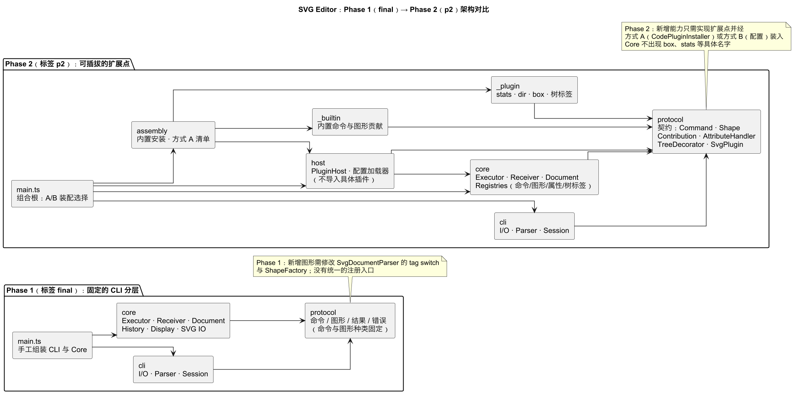

# Phase 1 → Phase 2 迭代报告

## 1. 目标与范围

Phase 2 的目标是把 Phase 1 的固定 CLI 改造成可插拔的扩展架构，并用真实插件验证扩展点是否足够：

- 命令、图形、属性、树标签四类扩展点各有明确契约和注册入口；
- 插件可以通过代码（方式 A）或配置文件（方式 B）装入，两种方式的输出逐字节一致；
- 删除任意一个插件，内核与其他插件不需要修改；
- 有插件与无插件时，文件仍可读写，行为有明确降级规则。

交付范围对照 `docs/pj1-phase2-2/phase_cli_2.md` 的 §2（stats / dir）、§3（set 与撤销）、§4（box）、§5（树标签）、§6（双装配）和 §7（交付物）。

## 2. 迭代过程

基线为标签 `final`（Phase 1 结束）。Phase 2 的主要迭代如下（提交号以 `git log final..p2` 为准）：

| 阶段 | 主要内容 | 代表提交 |
|---|---|---|
| 内核整理 | 内置命令从 `protocol` 迁入 `_builtin`，由组合根注册；移除 `CommandType`，命令身份由贡献名表达 | `1438f1b`、`b543754` |
| 扩展点建立 | `ShapeContribution` / `ShapeRegistry` 替代 `ShapeFactory`；`AttributeHandler` 与 `set` 路由；`TreeDecorator` 挂到树渲染 | `316194c`、`401e307`、`958c537` |
| 插件实现 | stats、dir、box（图形 + fill/label 属性 + 树标签）、modified-star | `b1862d4`、`e210fe0`、`b980795`、`70bea6a` |
| 装配与宿主 | `PluginHost`、配置加载器、方式 A（`CodePluginInstaller`）与方式 B（`plugins.config.json`）；装配移出 `host` | `afd7169`、`b546033` |
| 整改 | 扩展点改为抽象类；`dir` 码点序与符号链接规则；加载器向上查找包根清单 | `33bee5e`、`113cc57`、`1b030ec` |
| 验证 | 黑盒 E2E 按 spec §2–§6 逐条断言；双装配校验；metrics 基于 TypeScript AST | `062071c`、`f5af770`、`06b46e2` |
| 文档 | ADR 0001–0005、扩展点违约位置、模式角色与替代方案 | `3bf2752`、`2da28fe`、`3c81cee`、`e59f113` |
| 删除→加回演示 | 四个插件各一对 `delete-plugin-*` / `install-plugin-*` 提交，记录删除后失败的测试 | `238b3e3` … `9641371` |

迭代中出现过一次回退：`60483ef` 回退了一版错误的命令插件实现，随后以 `16a283b`、`f514550` 重新建立契约与运行时。

## 3. 架构变化

对比图源文件：[`architecture-comparison.puml`](./architecture-comparison.puml)；Phase 2 详细依赖图：[`architecture-phase2.puml`](./architecture-phase2.puml)。

| 维度 | Phase 1（`final`） | Phase 2（`p2`） |
|---|---|---|
| 目录 | `main`、`cli`、`core`、`protocol` | 新增 `host`、`assembly`、`_builtin`、`_plugin` |
| 新增图形 | 修改 `SvgDocumentParser` 的 tag switch 与 `ShapeFactory` | 实现 `ShapeContribution` 并注册到 `ShapeRegistry` |
| 新增命令 | 修改 CLI 解析与 Core 的装配 | 实现 `CommandContribution`，由 `BuiltinContributionInstaller` 或插件注册 |
| 属性 | 只有叶子图形白名单 | `AttributeHandler` 认领，未命中再走白名单 |
| 树标签 | 无 | `TreeDecorator` 按注册顺序拼接行尾标签 |
| 插件装入 | 无 | 方式 A（代码清单）与方式 B（配置文件）双路径，共用 `PluginHost` |
| 依赖约束 | 分层约定 | `npm run lint` 强制：`protocol` 不依赖外部；`core`/`cli`/`host` 不依赖插件；每个插件包只依赖 `protocol` 与自身 |

## 4. 指标变化

由 `npm run metrics`（`scripts/generate-metrics.mjs`）从 git 对象生成，口径见 [`docs/metrics/summary.md`](../docs/metrics/summary.md)。下表基线为 `final`，终点为 `p2`。

| 类别 | 文件数 | 行数 | 圈复杂度 |
|---|---:|---:|---:|
| Phase 1 CLI 合计（`final`） | 95 | 4999 | 803 |
| Phase 2 CLI 合计（`p2`） | 165 | 7628 | 1214 |
| 增量 | +70 | +2629 | +411 |

增量中，`_plugin` 为 18 个文件、665 行、复杂度 111，约占行数增量的四分之一；装配处（`main.ts`、`host`、`assembly`）为 12 个文件、746 行、复杂度 123；其余增量为内核（`protocol`、`core`、`cli`、`_builtin`）中的扩展点契约、注册表、命令贡献化和 `box` 相关的内核钩子。

## 5. 验证结果

| 验证项 | 结果 |
|---|---|
| `npm test` | 221 / 221 通过 |
| Phase 2 黑盒验收 `tests/e2e/Phase2Acceptance.test.ts` | 31 项，按 spec §2–§6 分组 |
| `npm run build` | 通过 |
| `npm run verify:dual-assembly` | 方式 A 与方式 B 输出一致；与基线逐字节对照 |
| `npm run lint` | 分层导入约束通过 |
| `npm run e2e` | Phase 1 编辑闭环、显示、SVG 读写与历史锁通过 |
| VSCode 扩展单元测试（`vscode-extension`） | 5 / 5 通过 |
| VSCode 扩展宿主集成测试 | 3 / 3 通过；覆盖装饰注册、大纲层级与源码范围、编辑更新、损坏 XML 和伪 id 属性值 |

删除提交的失败测试逐条记录在 [`docs/facts/plugin-removal-demo.md`](../docs/facts/plugin-removal-demo.md)。删除后失败的测试是有意保留的：它们说明删除插件的影响面集中在共享测试与期望输出上，内核目录没有受影响。

## 6. 设计决策与模式

主要决策记录在 ADR：

- [ADR 0001](../docs/adr/0001-attribute-handler-contract.md)：AttributeHandler 契约、`set` 路由与访问图形的方式；
- [ADR 0002](../docs/adr/0002-box-svg-read-degradation.md)：box 的 SVG 读回与无插件降级；
- [ADR 0003](../docs/adr/0003-tree-dirty-semantics.md)：modified-star 的 dirty 语义；
- [ADR 0004](../docs/adr/0004-plugin-manifest-validation.md)：配置清单校验时机与回滚；
- [ADR 0005](../docs/adr/0005-box-child-ids-and-invariants.md)：box 子部件 id 派生与结构不变量；
- [ADR 0006](../docs/adr/0006-layering-and-builtin-split.md)：分层边界与 `_builtin` / `protocol` 拆分；
- [ADR 0007](../docs/adr/0007-command-aggregation.md)：命令按目录聚拢与名字分派集中；
- [ADR 0008](../docs/adr/0008-shape-contribution-replaces-factory.md)：图形贡献替代 `ShapeFactory`；
- [ADR 0009](../docs/adr/0009-extension-points-as-abstract-classes.md)：扩展点用抽象类，能力协议用接口；
- [ADR 0010](../docs/adr/0010-directory-listing-port.md)：文件系统访问经 `DirectoryListing` 端口。

各模式的参与者、解决的问题与替代方案见 [`doc/README.md`](./README.md) §3。

## 7. 已知限制与后续事项

- `p2` 标记最终代码与文档提交；metrics 按交付约定在其后以 `p2` 为终点重新生成并单独提交。
- 发布步骤会将 `main` 与 `p2` 推送至远程 `origin`。
- 两张 PNG 由 PlantUML 1.2024.8 渲染（`java -Djava.awt.headless=true -jar plantuml.jar -tpng -graphvizdot <dot> <puml>`）。源文件改动后需要重新渲染。
- 拓展任务（选做）未实施。
