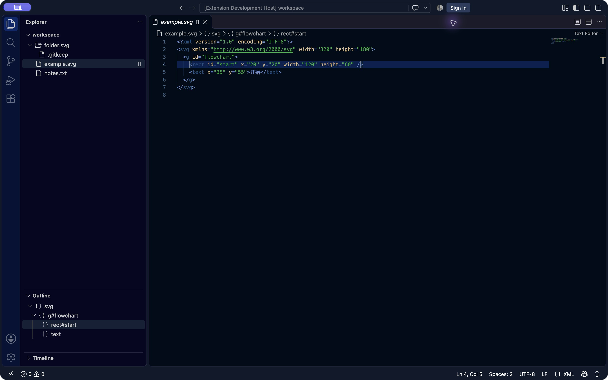

# A.3 VSCode SVG 扩展分析与复用评估

## 1. VSCode 与扩展的职责

VSCode 负责：

- 管理 Explorer、编辑器、Outline 等界面。
- 发现并启动扩展。
- 在资源出现、文档打开或源码变化时调用扩展注册的 Provider。
- 根据 Provider 返回值渲染 `[]` 和大纲树。
- 处理大纲点击，并将光标移动到 Provider 给出的源码范围。

实现前在 Extension Development Host 中观察到：没有 DocumentSymbol Provider 时原生
Outline 显示无信息；注册后 VSCode 按 `DocumentSymbol.children` 展示层级，按
`selectionRange` 处理点击定位，并在活动文档文本变化后重新调用 Provider。因此实现选择
接入原生 Outline Provider，而不是创建自定义 Tree View。

扩展负责：

- 判断资源是否为普通 SVG 文件。
- 解析当前 SVG 文本，生成元素和源码范围。
- 将解析结果转换成 VSCode 需要的 `FileDecoration` 与 `DocumentSymbol`。
- 对不完整 XML 做降级处理，避免影响 VSCode 运行。

扩展入口位于 `vscode-extension/src/extension.ts`。激活时分别调用：

```ts
vscode.window.registerFileDecorationProvider(fileDecorationProvider);
vscode.languages.registerDocumentSymbolProvider("*", documentSymbolProvider);
```

`SvgDocumentSymbolProvider` 内部再次检查文件扩展名，因此注册范围虽然宽，实际只处理
`.svg` 文件。

调用关系如下：

```text
文件资源
  └── VSCode Explorer
      └── SvgFileDecorationProvider.provideFileDecoration()
          └── 返回 badge: "[]"

打开或编辑 SVG
  └── VSCode Outline
      └── SvgDocumentSymbolProvider.provideDocumentSymbols()
          ├── SvgOutlineParser.parse()
          ├── SvgDocumentNode.accept(SvgOutlineVisitor)
          └── 转换为 vscode.DocumentSymbol
```

## 2. 文件装饰与设计模式

### VSCode 文件装饰

`SvgFileDecorationProvider` 实现 VSCode 的 `FileDecorationProvider`。它只返回装饰
信息，例如：

```ts
{
  badge: "[]",
  tooltip: "SVG 文件",
}
```

VSCode 决定什么时候查询、怎样显示以及什么时候刷新。扩展没有替换 Explorer 中的文件
对象，也没有在调用前后包装文件行为。

### 与经典 Decorator 的对应关系

相似点：

- 两者都在不修改原对象内容的情况下增加界面或行为。
- 两者都希望调用方继续使用原始对象。

关键差异：

- 经典 Decorator 持有被装饰对象，实现同一个接口，并将调用委托给内部对象。
- VSCode 文件装饰是一个 Provider 回调。VSCode 调用扩展获取元数据，再由 VSCode
  自己渲染，扩展不持有 Explorer 文件对象。
- 禁用文件装饰只影响界面信息，不改变文件对象本身。

因此本项目把文件 `[]` 归类为“VSCode 扩展点 + 数据适配”，不称为经典 Decorator。

### Adapter 对应关系

- `SvgFileDecorationProvider`：把 SVG 文件策略适配为 VSCode
  `FileDecorationProvider`。
- `SvgDocumentSymbolProvider`：把本扩展的元素树和中立大纲对象适配为
  `vscode.DocumentSymbol`。

Adapter 的收益是领域代码和解析器不直接依赖 `vscode` 模块，可以在普通 Node 测试中
运行。

## 3. SVG 树与 Visitor

### Composite

- `SvgNode`：统一节点入口，声明 `accept`。
- `SvgDocumentNode`：持有唯一根元素。
- `SvgElementNode`：持有标签名、id、源码范围和子元素。

容器和叶子使用统一的 `SvgElementNode` 访问方式。实际区别由子元素集合表达，因此调用
方不需要根据标签名写分支。

如果直接用带 `tagName`、`children` 字段的普通对象，代码会更短，但对象没有明确
行为入口，后续新增操作会继续在外部散落 `instanceof` 或字段判断。

### Visitor

- 访问者接口：`SvgNodeVisitor<T>`。
- 具体访问者：`SvgOutlineVisitor`。
- 双分派入口：`SvgNode.accept()` 调用具体的 `visitDocument` 或 `visitElement`。
- 本次操作：递归生成 `SvgSymbolDto`。

Visitor 适合这里的原因是树结构稳定，而“遍历后做什么”会扩展。未来可以增加统计标签
数量、导出节点列表等访问者，不必修改节点数据类。

如果只有一个大纲输出，直接在 Provider 中递归也能完成；但那会让解析模型与 VSCode
类型耦合，也不方便在普通单元测试中验证遍历。当前规模下 Visitor 的教学价值大于它节省
的代码量，所以实现保持小而集中，没有引入更多模式。

## 4. Phase 1 代码复用评估

| Phase 1 模块 | 能否直接复用 | 原因 |
|---|---|---|
| `CommandLineParser`、命令 Tokenizer | 否 | 解析的是 CLI 命令文本，不是 SVG XML |
| `SvgDocumentParser` | 否 | 只保留六种可编辑图形；会为无 id 元素分配 id；不保留源码偏移；损坏 XML 直接抛错 |
| `Shape`、`GroupShape` | 否 | 领域模型包含移动、缩放、样式等编辑语义，且只接受已支持图形；本任务需要展示任意 SVG 标签 |
| `ShapeFactory` | 否 | 按可编辑图形类型创建对象，没有通用 XML 节点和源码范围 |
| `ShapeVisitor` | 否 | 接口方法绑定具体图形类，增加任意 SVG 标签会不断扩接口 |
| `fast-xml-parser` 配置 | 部分思路可参考 | 可解析普通 XML，但现有配置丢弃源码位置和未知标签，不满足大纲定位与容错要求 |

最终选择独立实现 `SvgOutlineParser`：

- 保留任意标签名。
- 保留开始标签和完整节点偏移。
- 跳过注释、声明、DOCTYPE、CDATA。
- 对不完整 XML 返回空结果，不让扩展崩溃。

CLI 和 VSCode 扩展共享的设计思路是 Composite + Visitor，但没有强行共享具体类，因为
两者的领域语义不同：CLI 关心可编辑图形，VSCode 大纲关心任意 SVG 语法元素及其源码
位置。

## 5. 验证证据

实际 Extension Development Host 截图展示了：

- `example.svg` 右侧的 `[]`。
- `folder.svg` 目录没有标记。
- 原生 Outline 的 `svg → g#flowchart → rect#start/text` 层级。
- 选中 `rect#start` 后光标位于第 4 行第 5 列。



自动化验证：

- `SvgOutlineParser` 单元测试覆盖嵌套、id、无 id、自闭合、注释、CDATA、损坏 XML。
- `SvgOutlineVisitor` 测试验证 Composite 与 Visitor 的双分派。
- VSCode 宿主测试验证文件装饰、目录过滤、大纲层级、编辑后更新和异常输入。
