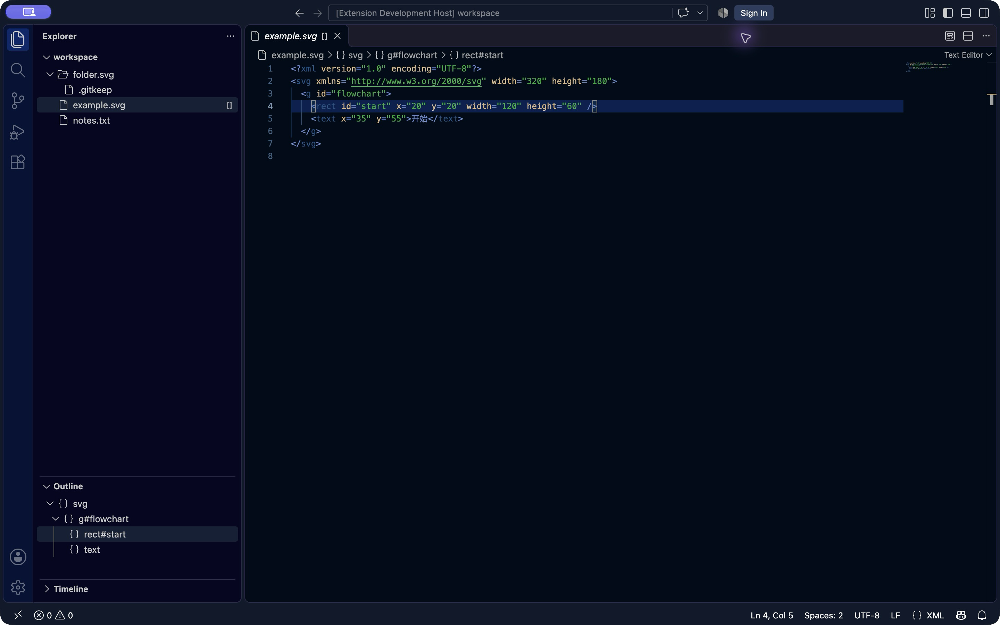

# SVG Editor VSCode 扩展

这个扩展只负责 VSCode 中的两件事：

- 在 Explorer 中给普通 `.svg` 文件显示 `[]`。
- 在原生 Outline 中展示 SVG 元素的嵌套层级，并支持点击定位。

它不修改 SVG 文件，也不实现图形预览或完整 XML 校验。



## 作为扩展开发运行

环境要求：

- Node.js 22 或兼容版本
- VSCode 1.95 或更高版本

先编译扩展：

```bash
cd vscode-extension
npm install
npm run build
```

然后任选一种方式启动：

1. 用 VSCode 打开 `vscode-extension/`，按 `F5`。
2. 从终端启动 Extension Development Host：

```bash
code \
  --extensionDevelopmentPath="$PWD" \
  "$PWD/test-fixtures/workspace"
```

开发宿主打开后：

1. Explorer 中的 `example.svg` 右侧应显示 `[]`。
2. 打开 `example.svg`。
3. 展开左侧 Outline，应看到：

```text
svg
└── g#flowchart
    ├── rect#start
    └── text
```

4. 点击 `rect#start`，光标应定位到对应的 `<rect>` 行。

## 故障排查：终端 `code` 打开了 Cursor

Cursor 安装时可能把 `/usr/local/bin/code` 指向自己的 CLI，导致终端中的 `code`
打开 Cursor 而不是 VSCode。先确认链接目标：

```bash
type -a code
ls -l /usr/local/bin/code
```

如果输出包含：

```text
/usr/local/bin/code -> /Applications/Cursor.app/Contents/Resources/app/bin/code
```

可将 `code` 重新指向 VSCode：

```bash
sudo ln -sfn \
  "/Applications/Visual Studio Code.app/Contents/Resources/app/bin/code" \
  /usr/local/bin/code

hash -r
code --version
```

`code --version` 应显示 VSCode 版本，而不是 Cursor 版本。Cursor 更新后如果再次占用
该命令，重新执行上述链接命令即可。

不希望修改全局命令时，也可以直接使用 VSCode CLI 的完整路径启动扩展：

```bash
"/Applications/Visual Studio Code.app/Contents/Resources/app/bin/code" \
  --extensionDevelopmentPath="$PWD" \
  "$PWD/test-fixtures/workspace"
```

## 测试

```bash
npm test
```

测试分两层：

- Node 单元测试验证解析、嵌套、id、自闭合标签、注释、CDATA 和损坏 XML。
- VSCode Extension Development Host 集成测试验证文件装饰、原生 Outline 层级和编辑后更新。

## 文件标记规则

- 扩展名判断不区分大小写。
- 只有普通文件显示 `[]`。
- 目录即使名为 `folder.svg` 也不显示标记。
- 文件装饰失败或资源不存在时不显示标记。

## SVG 大纲规则

- `svg` 是根节点，容器和叶子按源码嵌套关系展示。
- 有 id 时显示 `标签名#id`，无 id 时只显示标签名。
- XML 声明、注释、DOCTYPE 和 CDATA 不生成大纲节点。
- 标签未闭合、开始结束标签不匹配或存在多个根元素时返回空大纲。
- 编辑文档后，VSCode 会重新调用 Provider 更新大纲。

## 设计说明

`SvgElementNode` 使用 Composite 维护嵌套结构；`SvgOutlineVisitor` 使用 Visitor
遍历节点并生成中立大纲对象；两个 VSCode Provider 使用 Adapter 将本扩展模型接入
VSCode 接口。

详细分析见
[`A.3 VSCode 扩展分析与复用评估`](../docs/pj1-phase2-2/vscode-extension/analysis.md)。
